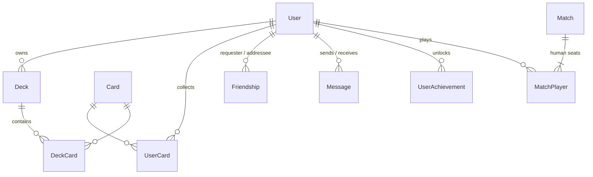

*This project has been created as part of the 42 curriculum by brcoppie, fkrakow, lecartuy, stdevis.*

# ft_transcendence — a collectible card game

> **TODO(team):** final name of the game (the app currently shows "ft_transcendence").

## Description

**ft_transcendence** is an online collectible card game in the spirit of Hearthstone: players
collect cards by opening packs, build decks, and battle each other or an AI in real time. The
server is the single authority on the rules; the browser only sends intentions and animates the
result.

Key features:

- **Accounts**: sign up / sign in with email (or username) and password, or with your **42**
  account; profile editing, avatar upload, password change that signs out other sessions.
- **Collection & decks**: open packs (weighted rarities, guaranteed legendary every 5 packs),
  browse your collection, build decks (1 legendary max, 20 other cards, only cards you own).
- **Matches**: real-time **player vs player** on two machines (matchmaking queue, 30 s
  reconnection window, forfeit) and **player vs AI** (Monte-Carlo tree search, 3 difficulties with
  human-like pacing and mistakes).
- **Social**: friends (requests, accept/decline, remove), **live online status**, **private
  chat** between friends, public profiles with match history.
- **Progression**: Elo leaderboard, 10 achievements with bronze/silver/gold badges, reward packs,
  unlockable card backs, per-mode win counters.
- **Everything over HTTPS/WSS**, secrets only in `.env`, inputs validated on both sides.

Full documentation (French) for the team and the evaluation: [`docs/`](docs/) — start with
[`docs/explications/00_VUE_ENSEMBLE.md`](docs/explications/00_VUE_ENSEMBLE.md).

## Instructions

### Prerequisites

| Tool | Version | Notes |
|---|---|---|
| Docker Engine + Docker Compose v2 | Docker 24+ / Compose 2.20+ | the only hard requirement |
| GNU Make | any | runs the compose commands |
| A 42 intra OAuth application | — | only for "Sign in with 42" (redirect URI below) |
| Google Chrome | latest stable | target browser |
| Node.js 20 + npm | optional | only to run tests/lint outside Docker |

### Configuration

```sh
cp .env.example .env
```

Fill in `.env` (every variable is documented in `.env.example`):

| Variable | What to put |
|---|---|
| `JWT_SECRET` | `openssl rand -base64 32` |
| `POSTGRES_USER`, `POSTGRES_PASSWORD`, `POSTGRES_DB` | any values (created on first start) |
| `FT_CLIENT_ID`, `FT_CLIENT_SECRET` | from your app on https://profile.intra.42.fr/oauth/applications |
| `FT_REDIRECT_URI` | `https://localhost:8080/api/auth/42/callback` (must be registered in the 42 app) |
| `DOMAIN_NAME` | production only (`make prod`): the public domain |

### Run

```sh
make            # build + start everything (development mode, hot reload)
```

Open **https://localhost:8080** and accept the self-signed certificate. Plain
`http://localhost:8080` redirects to HTTPS.

In development, three test accounts exist: `alexvanguard` / `test1`, `elenaspellweaver` /
`test2`, `kaicyberblade` / `test3` (never created in production). The `/packs` page has
development-only buttons to get packs or the whole collection quickly.

| Command | Effect |
|---|---|
| `make` / `make dev` | development stack on https://localhost:8080 |
| `make prod` | production images, HTTPS on 443 for `DOMAIN_NAME` |
| `make clean` | stop and remove the containers |
| `make fclean` | also delete volumes (**database, avatars**) |
| `make re` | `fclean` then `make` |

### Tests and checks (optional, outside Docker)

```sh
cd app && npm ci && npm test && npm run lint && npx tsc --noEmit
cd game_engine && npm ci && npm test && npm run lint && npx tsc --noEmit
cd socket-server && npm ci && npm run lint
```

## Resources

- [Next.js App Router](https://nextjs.org/docs/app), [React](https://react.dev/),
  [Tailwind CSS](https://tailwindcss.com/docs), [Prisma](https://www.prisma.io/docs),
  [Socket.IO](https://socket.io/docs/v4/) (+ Redis adapter / emitter), [Phaser 3](https://docs.phaser.io/),
  [React Three Fiber](https://r3f.docs.pmnd.rs/), [zod](https://zod.dev/), [jose](https://github.com/panva/jose).
- 42 intranet API: [OAuth 2.0 web application flow](https://api.intra.42.fr/apidoc/guides/web_application_flow).
- OWASP: [Password Storage](https://cheatsheetseries.owasp.org/cheatsheets/Password_Storage_Cheat_Sheet.html),
  [File Upload](https://cheatsheetseries.owasp.org/cheatsheets/File_Upload_Cheat_Sheet.html),
  [Cross-Site WebSocket Hijacking](https://owasp.org/www-project-web-security-testing-guide/latest/4-Web_Application_Security_Testing/11-Client-side_Testing/10-Testing_WebSockets).
- Monte-Carlo tree search: Browne et al., *A Survey of Monte Carlo Tree Search Methods* (2012);
  Cowling, Powley & Whitehouse, *Information Set Monte Carlo Tree Search* (2012).
- Elo rating system: [Wikipedia](https://en.wikipedia.org/wiki/Elo_rating_system).
- Art: *Complete UI Book Styles Pack* (license in `collection/Complete_UI_Book_Styles_Pack_Full_v1.0/License.txt`);
  card illustrations: see each card's `artist` field. **TODO(team):** complete the credits.

### Use of AI

- **Claude (Anthropic), in Claude Code**, was used for a final audit and finalisation pass
  (commits marked `Co-Authored-By: Claude`): security review and fixes (deck validation, OAuth
  account-linking takeover, password change, WebSocket origin checks, rate limiting, secrets in
  `.env.example`), HTTPS in development, the friends/chat/presence features, avatar upload,
  player search, achievements and match history, fixes to the MCTS AI and its human-like
  behaviour, zod validation, unit and end-to-end tests, lint cleanup, JSDoc comments, and the
  documentation in `docs/` and this README. Every change was reviewed and tested; the decisions
  taken are logged in [`docs/DECISIONS.md`](docs/DECISIONS.md).
- **TODO(team):** describe any other AI use by team members during development (which tasks,
  which parts).

## Team Information

> **TODO(team):** the roles below cannot be deduced from the code — fill them in.

| Member | Role(s) | Responsibilities |
|---|---|---|
| brcoppie | TODO(team) (PO / PM / Tech Lead / Developer) | TODO(team) |
| fkrakow | TODO(team) | TODO(team) |
| lecartuy | TODO(team) | TODO(team) |
| stdevis | TODO(team) | TODO(team) |

## Project Management

> **TODO(team):** how the work was organised (meetings, task tracking), tools (GitHub issues /
> projects, Notion, Trello…) and communication channels (Discord, Slack…).

Visible in the repository: one Git branch per member (`bribri`, `francois`, `leo`, `stef`) merged
into `dev`/`main`, Conventional-Commit-style messages in the final pass.

## Technical Stack

| Layer | Choice | Why |
|---|---|---|
| Frontend + backend framework | **Next.js 16** (App Router, React 19, Server Components, Route Handlers, Server Actions) | one framework for pages and API, server-side data access without a separate REST layer, file-based routing |
| Styling | **Tailwind CSS 4** with design tokens (`@theme`) + 9-slice pixel-art frames | consistent tokens, no CSS-in-JS runtime |
| Game rendering | **Phaser 3** (in-match), **three.js / React Three Fiber** (3D hub) | Phaser for a 2D card table with tweens/input; R3F for the 3D library hall |
| Game server | **Node.js + TypeScript + Socket.IO** (`game_engine/`) | authoritative real-time rules in a long-lived process, reconnection support |
| Chat / presence server | **Socket.IO + Redis adapter** (`socket-server/`) | rooms per user, pushes from the app through Redis, no database access |
| Database | **PostgreSQL 16** | relational data (users, friendships, decks, matches), transactions and unique constraints for concurrency, native arrays |
| ORM | **Prisma 7** (pg driver adapter) | typed queries, versioned migrations, schema shared by app and game server |
| Cache / bus | **Redis 7** | online presence and real-time event bus between services |
| Auth | **argon2id** (`@node-rs/argon2`), **JWT HS256** (`jose`) in an HttpOnly/Secure cookie, 42 OAuth 2.0 | OWASP-recommended hashing, stateless sessions revocable through `tokenVersion` |
| Validation | **zod** | one schema per input, shared by the forms and the server |
| Reverse proxy | **nginx** (TLS) | single HTTPS/WSS entry point, security headers |
| Tests / quality | **vitest**, **Playwright** (end-to-end runs), **ESLint** | unit tests of rules, AI and server logic; lint in all services |

## Database Schema



| Table | Purpose | Key fields |
|---|---|---|
| `User` | account, stats, rewards | `id` PK, `email` UQ, `username` UQ, `password` (argon2 hash, null for 42-only), `fortyTwoId` UQ, `tokenVersion`, `avatar`, `elo`, `unopenedPacks`, `pityCounter`, `winsVs*`, `cardBack`, `unlockedCardBacks int[]`, `packsOpened` |
| `Card` | card catalog | `id` PK (text), `name`, `rarity`, `cost`/`atk`/`def`, `qty` (max copies per player), keyword flags, effects as JSON (`battlecry`, `deathrattle`, `spellEffect`…) |
| `UserCard` | collection | PK (`userId`, `cardId`), `qty` |
| `Deck` / `DeckCard` | decks | `Deck.userId` FK; `DeckCard` PK (`deckId`, `cardId`), `qty` |
| `Friendship` | friendships | `requesterId`, `addresseeId` (UQ pair), `status` PENDING / ACCEPTED / BLOCKED |
| `Message` | private chat | `senderId`, `recipientId`, `content varchar(500)`, `createdAt` |
| `UserAchievement` | unlocked achievements | PK (`userId`, `key`), `unlockedAt` |
| `Match` / `MatchPlayer` | match history | `Match.mode` PVP / AI_EASY / AI_MEDIUM / AI_HARD, `endReason` hero / forfeit; `MatchPlayer` PK (`matchId`, `userId`), `won`, `eloChange` |

All user-owned rows are deleted with the user (`ON DELETE CASCADE`). Online presence is kept in
Redis, not in the database. Full diagram: [`docs/explications/00_VUE_ENSEMBLE.md`](docs/explications/00_VUE_ENSEMBLE.md).

## Features List

> Members per feature are **inferred from the Git history** (files each person committed) and
> must be confirmed. **TODO(team):** correct / complete.

| Feature | Description | Members (from Git, to confirm) |
|---|---|---|
| Authentication | email/username + password (argon2), sessions (JWT cookie), rate limiting | fkrakow, stdevis |
| Sign in with 42 | OAuth 2.0 flow, account creation, linking from the profile | fkrakow |
| Profile & avatar | edit profile, secure avatar upload, default avatar, public profiles | fkrakow, stdevis |
| Friends & presence | requests, accept/decline, remove, live online / in-match status | fkrakow |
| Chat | private messages between friends, real time, notifications | fkrakow |
| 3D hub & UI | library hall (three.js), notebook-style pages, design system | stdevis |
| Card packs & collection | weighted draws, pity timer, collection book, card backs | stdevis |
| Deck builder | build/edit decks with the deck rules | stdevis, lecartuy |
| Game engine | rules, card effects, targets, legendary passives | brcoppie, lecartuy |
| Game client | Phaser table, drag & drop, animations, match history | brcoppie |
| Multiplayer | matchmaking, authoritative server, reconnection, forfeit | brcoppie, stdevis |
| AI opponent | MCTS with determinization, difficulties, human-like play | brcoppie, lecartuy |
| Gamification | Elo, achievements & badges, rewards, leaderboard | stdevis |
| Player search | filters, sort, server-side pagination | stdevis |
| Infrastructure | Docker Compose, nginx TLS, Makefile | fkrakow |

## Modules

**Total: 19 points** (7 major × 2 + 5 minor × 1). How each one is implemented and how to demo it:
[`docs/explications/01_MODULES.md`](docs/explications/01_MODULES.md).

| # | Module | Type | Pts | Implementation | Members (from Git, to confirm) |
|---|---|---|---|---|---|
| 1 | Framework for frontend and backend (Next.js) | Major | 2 | pages, Server Components, Route Handlers, Server Actions | all |
| 2 | Real-time features using WebSockets | Major | 2 | game socket (`game_engine`), chat/presence socket (`socket-server`), targeted rooms | brcoppie, fkrakow |
| 3 | User interaction (chat, profile, friends) | Major | 2 | `/chat`, `/users/[username]`, `/friends` | fkrakow |
| 4 | ORM (Prisma) | Minor | 1 | `app/prisma/schema.prisma`, migrations, shared client | all |
| 5 | Custom design system (10+ components) | Minor | 1 | tokens + 16 components, `/design-system`, `docs/DESIGN_SYSTEM.md` | stdevis |
| 6 | Advanced search (filters, sort, pagination) | Minor | 1 | `/players` + `GET /api/users` | stdevis |
| 7 | Standard user management | Major | 2 | profile edit, avatar upload + default, friends with online status, profile pages | fkrakow |
| 8 | Remote authentication with OAuth 2.0 (42) | Minor | 1 | `app/api/auth/42/**`, `app/lib/oauth42.ts` | fkrakow |
| 9 | AI opponent | Major | 2 | `game_engine/srcs/ai/**` (MCTS, policy) | brcoppie, lecartuy |
| 10 | Complete web-based game | Major | 2 | `game_engine/srcs/gameEngine.ts` + Phaser client, rules in `/manual` | brcoppie |
| 11 | Remote players | Major | 2 | authoritative server, authenticated sockets, reconnection window | brcoppie, stdevis |
| 12 | Gamification | Minor | 1 | achievements, badges, Elo leaderboard, reward packs, card backs | stdevis |

**TODO(team):** add the justification of each module choice in your own words.

## Individual Contributions

> **TODO(team):** detailed breakdown per member (features, modules, components, challenges and
> how they were overcome). Starting points from the Git history:

- **brcoppie** — TODO(team) (commits mostly in the game engine, the Phaser client — objects,
  scenes, animations — and database migrations).
- **fkrakow** — TODO(team) (commits mostly in authentication, friends, the API, Prisma seeds,
  socket-server and the Docker/Makefile setup).
- **lecartuy** — TODO(team) (commits mostly in the game engine, API routes and the deck builder).
- **stdevis** — TODO(team) (commits mostly in the UI: hub, collection, packs, deck builder, API and
  lib code, assets).

## Known limitations

- The notebook-style pages (collection, deck builder, packs, manual, the game table) scale a
  fixed layout down on small screens: usable but small on phones in portrait. List pages
  (friends, chat, players, profiles, achievements) reflow properly; the hub switches to a text menu
  below 768 px.
- The TLS certificate is self-signed (browser warning); a real deployment needs a CA certificate.
- Matches live in the game server's memory: restarting `game_engine` ends running matches.
- Presence and rate-limit counters assume a single instance of each service.
- The `BLOCKED` friendship status exists in the schema but blocking is not implemented.
