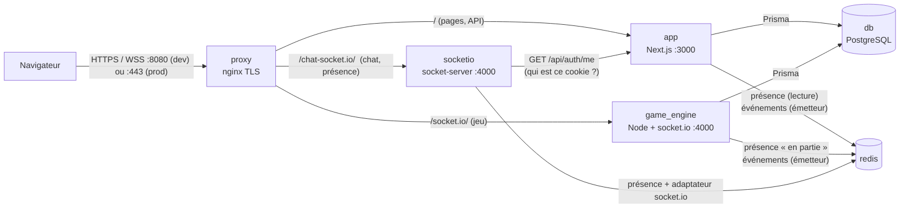
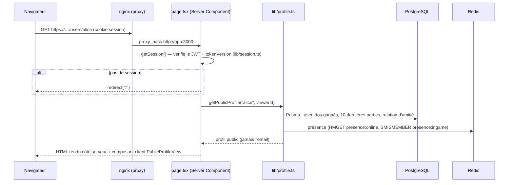
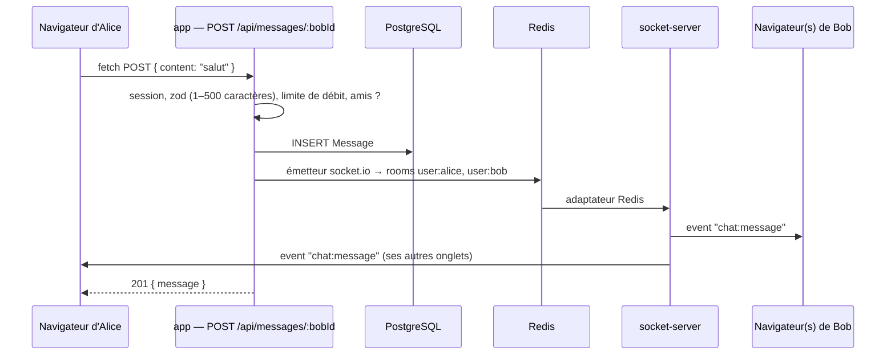
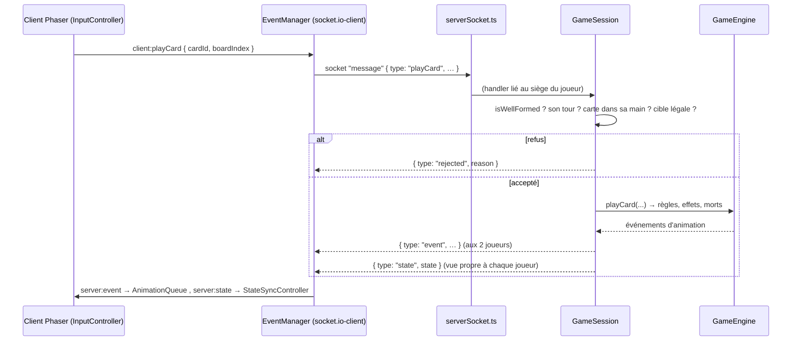
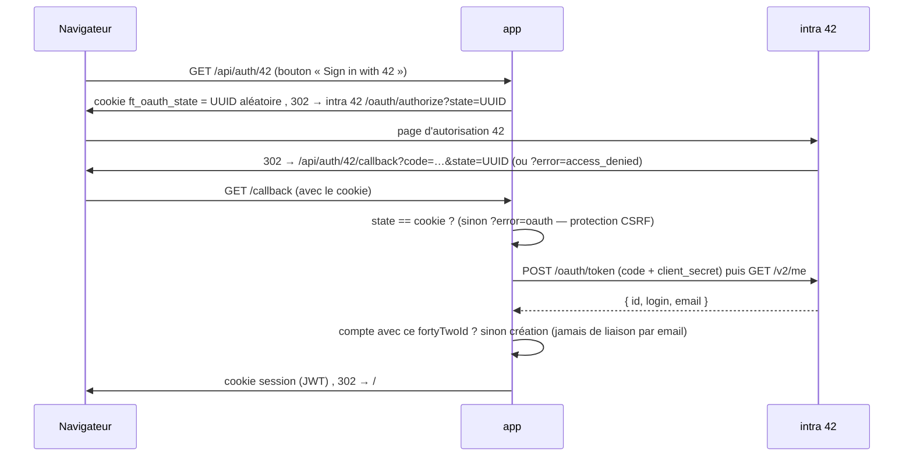
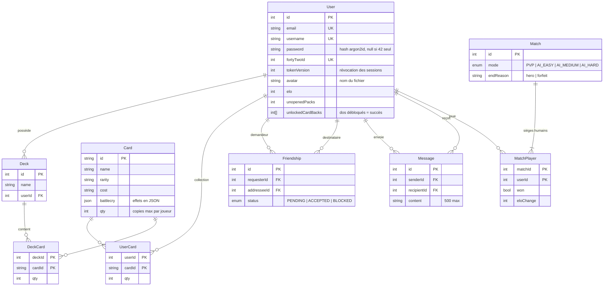

# Vue d'ensemble du projet

> Public : un étudiant qui doit **défendre et modifier** ce code en évaluation. Commence par ce
> fichier, puis suis l'« ordre de lecture conseillé » en bas. Chaque fichier source a sa propre
> page dans ce dossier, au même chemin : `app/lib/auth.ts` → `app/lib/auth.ts.md`.

## 1. Ce que fait le projet

**ft_transcendence** est un jeu de cartes à collectionner en ligne (dans l'esprit de
Hearthstone) :

- on crée un compte (email + mot de passe, ou « Sign in with 42 ») ;
- on ouvre des **paquets** pour obtenir des cartes, on construit des **decks** ;
- on joue des parties **contre l'IA** (3 difficultés) ou **contre un autre joueur** en temps réel,
  sur deux machines différentes ; le serveur arbitre chaque coup ;
- autour du jeu : **amis**, **chat privé**, **présence en ligne**, **profils publics** avec avatar,
  **classement Elo**, **succès (dos de cartes à débloquer)**, **historique des parties**.

## 2. Les conteneurs

Tout se lance avec `make` (docker compose). Six services :

| Service | Dossier | Rôle |
|---|---|---|
| `proxy` | `proxy/` | Seul point d'entrée. Termine TLS (certificat auto-signé généré au build), redirige HTTP → HTTPS, ajoute les en-têtes de sécurité, route vers les 3 services. |
| `app` | `app/` | Next.js 16 : toutes les pages (React), les routes API (`app/app/api/**/route.ts`), les *server actions* (connexion, inscription, profil). Lance les migrations et le seed au démarrage. |
| `game_engine` | `game_engine/` | Serveur de jeu **autoritaire** : règles, IA (MCTS), parties PvP, reconnexion, enregistrement des résultats. |
| `socketio` | `socket-server/` | Chat et présence : un socket par onglet connecté, rooms par utilisateur, présence dans Redis. |
| `db` | — | PostgreSQL 16, accédé uniquement via Prisma. |
| `redis` | — | Présence en ligne + bus d'événements temps réel entre services. |

En dev (`make`), le code est monté dans les conteneurs (rechargement à chaud) et le site est sur
**https://localhost:8080**. En prod (`make prod`), images optimisées, site sur le port 443.

## 3. Parcours d'une requête HTTP

Exemple : l'utilisateur ouvre la page d'un joueur, `/users/alice`.

Les routes API suivent le même schéma : `requireSession()` (lib/api.ts) → validation zod du corps
(`parseJsonBody`) → logique dans `lib/*.ts` → Prisma → réponse JSON `{ … }` ou `{ error }`.

## 4. Parcours d'un message WebSocket (chat)

Exemple : Alice envoie « salut » à Bob, son ami.

Le serveur de chat ne touche jamais la base : il authentifie chaque connexion en demandant à
l'app `GET /api/auth/me` avec le cookie reçu, puis il se contente de relayer vers des *rooms*.

## 5. Boucle de jeu serveur ↔ clients

Le **serveur décide de tout** ; le client n'envoie que des intentions et anime ce qu'on lui dit.

- **Contre l'IA** : après chaque fin de tour humaine, `GameSession.runAiTurnLoop` fait jouer l'IA
  (`ai/policy.ts` → recherche MCTS `ai/mcts.ts`), avec un temps de réflexion entre chaque coup.
- **Déconnexion** : le siège est gardé **30 s** (`RECONNECT_GRACE_MS`), l'adversaire est prévenu ;
  si le joueur revient (même compte), `reattach()` lui rend sa partie ; sinon **forfait**.
- **Fin de partie** : `finish()` enregistre le résultat en une transaction (`matchResults.ts` :
  victoires, paquets, dos de carte, Elo, historique) puis envoie `gameOver` avec les récompenses.

## 6. Flux OAuth 42

Liaison d'un compte existant : depuis `/profile`, bouton « Link 42 account » →
`/api/auth/42?link=1` ; au retour, le `fortyTwoId` est posé sur le compte **connecté**.

## 7. Schéma de la base

La présence en ligne n'est **pas** en base : elle vit dans Redis (voir `app/lib/presence.ts`).

## 8. Sécurité en un coup d'œil

| Menace | Protection | Où |
|---|---|---|
| Écoute réseau | HTTPS/WSS partout, cookies `Secure` | `proxy/`, `lib/session.ts` |
| Vol de mot de passe en base | argon2id salé | `lib/auth.ts`, `lib/constants.ts` |
| Force brute | limite des échecs par compte et par IP | `lib/rateLimit.ts` |
| Session volée | JWT signé, `HttpOnly`, révocation par `tokenVersion` au changement de mot de passe | `lib/session.ts`, `lib/updateUserProfile.ts` |
| CSRF | cookie `SameSite=Lax`, *server actions* vérifiées par Next (Origin), `state` OAuth | `lib/session.ts`, `api/auth/42` |
| Détournement de WebSocket | vérification de l'`Origin` sur les deux serveurs socket | `game_engine/srcs/socket/serverSocket.ts`, `socket-server/index.js` |
| Entrées malveillantes | schémas zod client + serveur, validation des messages de jeu | `lib/validation.ts`, `socket/validateMessage.ts` |
| Triche | serveur autoritaire, decks vérifiés contre la collection | `socket/gameSession.ts`, `lib/decks.ts` |
| Injection SQL | Prisma (requêtes paramétrées, y compris le SQL brut taggé) | partout |
| XSS | React échappe tout, aucun `dangerouslySetInnerHTML` ; avatars servis avec type fixé + `nosniff` + CSP sandbox | `api/avatars/[file]` |
| Upload dangereux | type détecté par signature binaire, 2 Mo, nom aléatoire, hors racine web | `lib/avatarStorage.ts` |

## 9. Ordre de lecture conseillé

1. `docker-compose.yml`, `Makefile`, `proxy/dev.conf` — comment tout démarre.
2. `app/prisma/schema.prisma` — les données.
3. `app/lib/session.ts`, `app/lib/auth.ts`, `app/lib/validation.ts` — l'authentification.
4. `app/app/layout.tsx`, `app/app/page.tsx`, `app/app/HubBackground.tsx` — l'interface.
5. `app/lib/api.ts` puis une route simple : `app/app/api/friends/route.ts`, puis `app/lib/friends.ts`.
6. `app/components/realtime/RealtimeProvider.tsx`, `socket-server/index.js`, `app/lib/realtime.ts` — le temps réel.
7. `game_engine/srcs/index.ts` → `socket/serverSocket.ts` → `socket/gameSession.ts` → `gameEngine.ts` — le jeu.
8. `game_engine/srcs/card.ts`, `effect.ts`, `target.ts`, `cardImport/effectFactory.ts` — les cartes.
9. `game_engine/srcs/ai/policy.ts` → `ai/mcts.ts` → `ai/tree.ts` — l'IA.
10. `app/game/EventManager.ts` → `scenes/GameScene.ts` → `scenes/gameProcessors/*` — le client de jeu.

Voir aussi : [01_MODULES.md](01_MODULES.md) (modules du sujet et comment les démontrer) et
[02_MODIFICATIONS_EVAL.md](02_MODIFICATIONS_EVAL.md) (modifications fréquentes en évaluation).
